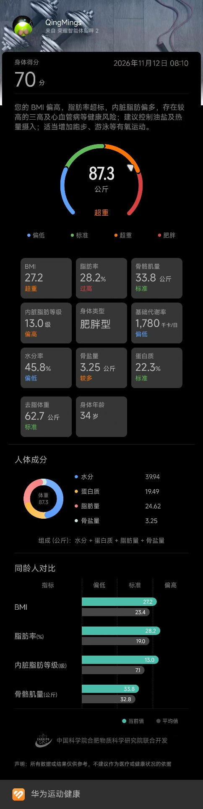

# 佳明体重助手

把**华为运动健康**里的体重 / 体脂数据，导出成 **Garmin Connect** 可以直接导入的 CSV 与 FIT 文件。

全程在本机处理：图片识别用本地 OCR（RapidOCR + ONNX 模型），手机走 USB + ADB 读控件树，不经过任何服务器。



## 功能

- **报告图片识别**：拖入华为「人体成分分析报告」截图，自动识别测量时间、体重、体脂率等 12 项指标，支持手工核对与修正。
- **手机直连采集**（不需要截图，也不跑 OCR）：
  - `⚡ 快速清单`：控件树直读历史列表，可从手机当前停留位置开始，边读边入表；
  - `🔍 详情全量`：逐条打开详情页读取全部指标；
  - `★ 全自动取报告`：自动完成「打开记录 → 分享 → 保存长图 → 拉回电脑 → 离线识别」。
- **两款手机已适配**：红米 Turbo 5 Max（HyperOS，`monkey` 注入）与华为 P30 Pro（EMUI 10，原生 `input`）。点按步骤按机型分别保存，互不覆盖。
- **中文时间格式**：支持华为的 12 小时制写法，如 `晚上8:02`、`半夜11:08`、`凌晨12:05`。
- **只有体重的记录也能保留**：没握电极、未测到脂肪率的称重记录会以「只有体重」的形式进入导出文件。
- **导出**：`garmin_import.csv`（Garmin 网页「导入数据」用）和 `garmin_weight.fit`（支持中国区 `connect.garmin.cn` 与国际区 `connect.garmin.com`）。

## 下载安装

到 [Releases](https://github.com/QingMings/HUAWEI_weight2GarminFit/releases) 下载：

- `佳明体重助手_vX.Y.Z_安装包.exe`：双击安装，默认装到当前用户目录，**不需要管理员权限**；
- `GarminWeightHelper_vX.Y.Z_portable.zip`：绿色版，解压后运行 `GarminWeightHelper.exe`。

系统要求：Windows 10 / 11（64 位）。程序依赖系统自带的 ICU 组件，不支持 Windows 7。

## 使用

1. 打开程序，把华为运动健康的报告截图拖进右侧，或按下面步骤连接手机。
2. 手机连接（首次）：
   - 设置 → 关于手机 → 连续点「版本号」开启开发者选项；
   - 开发者选项里打开「USB 调试」，USB 连接方式选「传输文件 / MTP」；
   - 手机上弹出「允许 USB 调试」时点允许（可勾选「一律允许」）。
3. 让手机停在华为运动健康的体重页，点「刷新手机」确认识别到机型。
4. 按需点击 `快速清单` / `详情全量` / `全自动取报告`。
5. 核对表格后点「生成佳明文件」，再用「打开佳明导入页」到 Garmin 网页导入。

> 换手机后如果要使用「重放录制步骤」，需要在新手机上点一次「录制点按步骤」。两款手机的配置是分开保存的，不会互相影响。

## 从源码运行

```powershell
python -m pip install -r desktop/requirements.txt
python desktop/main.py
```

也可以双击 `desktop/启动软件.bat`（首次会联网安装依赖，之后断网可用）。

开发环境为 Python 3.13 + PySide6 6.12。

## 构建

本地一键构建（回归测试 → PyInstaller → Inno Setup 安装包）：

```powershell
powershell -ExecutionPolicy Bypass -File .\build.ps1
```

- `-SkipTests` 跳过测试，`-SkipInstaller` 只生成 exe 目录；
- 需要 Inno Setup 6（未安装时只输出 exe 目录）。

持续集成（[build.yml](.github/workflows/build.yml)）：

- 推送到 `main`：在 GitHub Actions 上跑测试并构建，产物作为 artifact 上传；
- 推送 `v*` 标签：额外创建 Release，附带安装包与绿色版压缩包。

## 项目结构

```
desktop/          桌面程序（PySide6）
  main.py         界面与流程编排
  phone.py        ADB 桥接、控件树解析、点按宏
  fast_collect.py 快速清单（列表直读）
  detail_*.py     详情页采集与指标配对
  auto_collect.py 全自动取报告状态机
  GarminWeightHelper.spec / installer.iss  打包配置
sync_tool/        华为数据解析与 Garmin CSV / FIT 生成
tests/            回归测试（unittest，离线运行）
```

## 常见问题

- **列表里年份前后跳变**：华为「所有数据」列表按记录同步顺序排列，不一定按测量时间。程序读完会按真实测量时间从新到旧整理，数据本身不会丢。
- **红米上电脑点击无效**：HyperOS 拦截了常规注入，程序会自动改用 `monkey` 脚本；可点「注入自检」确认。
- **exe 图标显示空白**：Windows 图标缓存，刷新文件夹或复制一份改名即可。
- **导出的 CSV 被占用**：生成前请关闭 Excel 中打开的旧文件。

## 隐私

所有数据只在本机处理，程序不联网上传。仓库中的报告截图与样例数据为作者本人数据，并同意公开；你可以用自己的截图替换 `samples/` 下的文件。

## 免责声明

本项目是非官方工具，与 Garmin、华为均无关联。使用前请自行确认数据准确性，导入 Garmin 后以 Garmin 显示为准。
