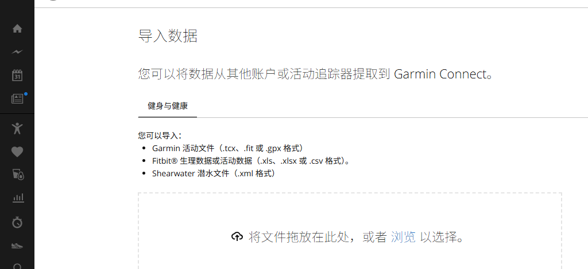

# 使用教程

从第一次打开程序，到把数据成功导入 Garmin Connect 的完整流程。

目录

1. [安装与启动](#1-安装与启动)
2. [界面总览](#2-界面总览)
3. [方式一：识别报告截图](#3-方式一识别报告截图)
4. [方式二：USB 连接手机自动采集](#4-方式二usb-连接手机自动采集)
5. [导出并导入 Garmin](#5-导出并导入-garmin)
6. [设置项说明](#6-设置项说明)
7. [常见问题](#7-常见问题)

---

## 1. 安装与启动

### 安装版

双击 `佳明体重助手_vX.Y.Z_安装包.exe`，按提示下一步即可：

- 默认装到当前用户目录（`%LOCALAPPDATA%\Programs\佳明体重助手`），**不需要管理员权限**；
- 会自动创建桌面快捷方式和开始菜单项；
- 卸载不会删除你的导出数据和手机点按步骤。

如果希望装到 `Program Files`，右键安装包选择「以管理员身份运行」。

### 绿色版

解压 `GarminWeightHelper_vX.Y.Z_portable.zip` 到任意目录，双击 `GarminWeightHelper.exe` 运行。整个文件夹要一起拷贝，不能只拷 exe。

### 数据存放位置

| 内容 | 位置 |
| --- | --- |
| 导出文件（CSV / FIT） | `%LOCALAPPDATA%\GarminWeightHelper\out\desktop` |
| 手机点按步骤 | `%LOCALAPPDATA%\GarminWeightHelper\phone_steps.json` |
| 运行日志与错误记录 | `%LOCALAPPDATA%\GarminWeightHelper\logs` |

窗口里点「打开输出文件夹」可直接定位到导出目录。

> 首次识别图片时会联网准备离线 OCR 组件，之后断网也能识别。

---

## 2. 界面总览

窗口从上到下大致分为四块：

1. **顶部选项**：佳明账号区域、身高、肌肉量口径、OCR 设置。
2. **手机取图栏**：连接状态、`最多 N 条`、三个采集按钮，以及「辅助」里的录制 / 重放 / 自检 / 指引。
3. **识别区**：左侧原图（可缩放，点击右侧数值行可定位到图中位置），右侧识别结果（数字可直接修改，状态实时重算）。
4. **清单与导出**：待导入清单（可勾选、去重、手工新增）和「生成佳明文件」。

不使用手机也能完整工作：直接用图片识别，或手工新增记录。

---

## 3. 方式一：识别报告截图

适合：只有几张报告截图，或手机不方便连 USB。

1. 把华为运动健康的「人体成分分析报告」长图拖进窗口，或点「选择图片（可多选）」。
2. 程序自动识别测量时间、体重、体脂率等指标，结果出现在右侧。
3. 核对数值：
   - 点右侧任意一行，左侧原图会定位到对应位置，方便确认小数点；
   - 识别错的数字直接改，状态会立即重算；
   - 改了图/换了引擎后，可点「重新识别当前图」。
4. 确认无误后，记录会自动进入下方的待导入清单。

小提示：

- 报告必须是**人体成分分析报告**（有体重、体脂率等指标）。只有体重的普通称重记录无法分享成长图，请改用手机直连方式。
- 图片不上传任何服务器，识别全部在本机完成。

---

## 4. 方式二：USB 连接手机自动采集

适合：一次性导出几十上百条历史记录。

### 4.1 手机端准备（只需做一次）

不同品牌路径略有差异，程序里的「连接指引」也写了同样的步骤：

**华为 P30 Pro（EMUI 10）**

1. 设置 → 关于手机 → 连续点 7 次「版本号」，开启开发者模式；
2. 设置 → 系统和更新 → 开发人员选项 → 打开「USB 调试」；
3. USB 连接电脑后，下拉通知栏选择「传输文件」；
4. 手机弹出「允许 USB 调试吗？」时点「允许」，可勾选「一律允许使用这台计算机进行调试」。

**红米 Turbo 5 Max（HyperOS）**

1. 设置 → 我的设备 → 全部参数与信息 → 连续点「OS 版本」开启开发者模式；
2. 设置 → 更多设置 → 开发者选项 → 打开「USB 调试」；
3. USB 连接后选择「传输文件」；
4. 弹出授权提示时点「允许」。

连接成功后，窗口顶部会显示机型，例如「华为 P30 Pro（VOG-AL00） · 1080×2340」。没显示就点「刷新手机」。

### 4.2 打开华为运动健康的体重页

在手机里进入：华为运动健康 → 健康 → 体重，停在体重首页或「所有数据」列表页。采集过程中**不要操作手机**，程序会自己点击和滚动。

### 4.3 三种采集方式怎么选

| 按钮 | 做什么 | 适合 |
| --- | --- | --- |
| `⚡ 快速清单（控件树直读）` | 逐屏读取历史列表的「时间 + 体重 + 体脂率」，不打开详情 | 快速拉取大量记录 |
| `🔍 详情全量（控件树直读）` | 逐条打开详情页，读取全部指标 | 需要骨骼肌、水分、基础代谢等完整数据 |
| `★ 全自动取报告` | 自动「打开记录 → 分享 → 保存长图 → 拉回电脑 → 离线识别」 | 想要和手动截图一致的高精度结果 |

共同注意事项：

- **最多 N 条**：控制本次采集的上限，想一次导完历史可以填 200 甚至更大；
- 采集过程中随时可以点「停止」，已读到的记录会保留；
- 三种方式都基于控件树，分辨率不同也能正确点击，不会因为换手机而点错位置。

**快速清单**点了之后会让你选起点：

- `从当前位置`：接着手机当前停留的地方往下读，适合增量导出；
- `从头开始`：先滚回列表顶部再读全部。

**只有体重的记录**：没有握电极、没测到脂肪率的称重记录无法生成体成分报告。勾选「普通称重也收进清单（仅体重）」后，程序会改用列表里的「时间 + 体重」写入，这条记录不会丢。

### 4.4 关于「录制点按步骤」

这是给特殊场景准备的兜底功能（例如系统界面改版导致固定按钮找不到）：

1. 连接手机，点「录制点按步骤」；
2. 在弹出的手机实时画面上依次点出你要执行的每一步（打开记录、分享、保存等）；
3. 点「完成并保存」。

之后点「重放录制步骤」就会按录制顺序自动点击，并拉回新保存的图片。

> 录制坐标**按机型分别保存**。红米和华为 P30 Pro 各有一套，互不覆盖。换新手机后如果要用这个功能，需要在新手机上重新录一次。
>
> 另外，「快速清单」「详情全量」「全自动取报告」都不依赖录制步骤，换手机可以直接用。

其他辅助按钮：

- `注入自检`：检查电脑能否模拟点击。红米 HyperOS 会拦截常规注入，程序会自动改用 `monkey` 脚本通道；
- `手机投屏`：打开 scrcpy 窗口，在电脑上直接操作手机（可选）；
- `抓取手机屏幕`：把手机当前画面拉到电脑并立即识别，一屏放不下时建议用报告长图。

---

## 5. 导出并导入 Garmin

### 5.1 生成文件

在待导入清单里勾选要导出的记录（可先点「🔀 去重」按「测量时间 + 体重」合并重复项），然后点「生成佳明文件」。

会在输出目录生成两个文件：

| 文件 | 用途 |
| --- | --- |
| `garmin_import.csv` | 在 Garmin Connect 网页「导入数据」 |
| `garmin_weight.fit` | 直接上传 FIT 文件，兼容性更好 |

CSV 只有日期、体重、BMI、体脂率四列；FIT 会带上更多可用字段。想保留完整指标时优先用 FIT。

### 5.2 打开佳明导入页面

点程序的「打开佳明导入页」，会按顶部选择的区域打开对应站点；也可以手动访问：

| 区域 | 导入页地址 |
| --- | --- |
| 中国区 | `https://connect.garmin.cn/app/import-data` |
| 国际区 | `https://connect.garmin.com/app/import-data` |

账号数据在哪个区就选哪个区，两边数据不互通。如果地址被重定向到首页，说明需要先登录。

导入页长这样（左侧菜单里也有「导入数据」入口）：

### 5.3 导入界面的具体操作

1. **登录**：用你平时手机 Garmin Connect 的账号登录。
2. **进入导入页**：打开上面的地址，或点左侧菜单的「导入数据」。
3. **选择文件**：页面上写着「将文件拖放在此处，或者 浏览 以选择」——
   - 把 `garmin_weight.fit` 或 `garmin_import.csv` 直接拖进虚线框；
   - 或者点蓝色的「浏览」，选中文件。
   一次传一个文件，两种格式分开导入。
4. **确认导入**：选好文件后点左下方蓝色的「导入数据」按钮，等待提示完成。
5. **核对结果**：点左侧「体重」进入体重页面，确认：
   - 日期和测量时间是否与报告一致；
   - 体重、体脂率数值是否正确；
   - 只有体重的记录是否也在列表里（这类记录没有体脂率，属正常）。

页面上列出的支持格式是「Garmin 活动文件（.tcx、.fit、.gpx）」「Fitbit 数据（.xls、.xlsx、.csv）」「Shearwater 潜水文件（.xml）」。体重数据用 `.fit` 或 `.csv` 导入即可，`garmin_import.csv` 就属于这里的 CSV 通道。

导入过程中不要关闭页面；文件较大时（几百条）可能需要等几秒到几十秒。

### 5.4 导入常见提示

- **同一个文件不要重复导入**：佳明不会自动去重，重复导入会在列表里出现两条相同时间的记录。导入前可先在程序里点「🔀 去重」。
- **CSV 与 FIT 选一个即可**：两者包含相同记录时会造成重复。
- **时区**：文件里写的是本地时间，导入后日期应与手机上的报告一致。如果整体偏移了几个小时，检查电脑时区和手机是否一致后重新生成。
- **导入失败**：多半是文件正被 Excel 打开（Windows 会锁文件），关掉 Excel 再重新生成；也可能是文件被手动改过列名，建议重新生成一份。
- **提示格式不支持**：确认上传的是 `garmin_import.csv` 或 `garmin_weight.fit`，不要用 Excel 另存的其他 CSV（编码或表头可能被改动）。
- **中国区账号导入国际区**：会显示成功但「体重」页看不到数据，重新在正确区域的站点导入即可。

---

## 6. 设置项说明

| 选项 | 说明 |
| --- | --- |
| 佳明账号 | 中国区 / 国际区，决定「打开佳明导入页」跳转的站点 |
| 身高 (cm) | 报告缺少身高时用于推算 BMI，默认 179.2 |
| 肌肉量口径 | 骨骼肌量 / 肌肉量，不同报告字段口径不同，影响写入 Garmin 的数值 |
| OCR 设置 | 切换识别引擎，识别结果异常时可换一个再试 |
| 最多 N 条 | 手机采集的条数上限 |
| 普通称重也收进清单（仅体重） | 见 4.3 |

---

## 7. 常见问题

**列表里年份突然从 2024 跳到 2025？**

这是华为「所有数据」列表自己的排序问题：它按记录同步顺序排，不按测量时间排。程序读完会按真实测量时间从新到旧整理，数据本身没有错，也不会丢失。详情页里的时间与列表分组头是一致的。

**提示「拒绝访问」或启动就报 PermissionError？**

说明数据目录不可写。程序会依次尝试 `%LOCALAPPDATA%`、`%APPDATA%`、`%TEMP%` 和 exe 所在目录；如果都被安全软件拦截，请把程序目录加入白名单。

**红米上电脑点击没反应？**

HyperOS 拦截了常规注入。程序会自动使用 `monkey` 脚本通道；可点「注入自检」确认是否可用。

**快速清单读到的条数比手机里少？**

- 检查「最多 N 条」是否设得太小；
- 只有体重的记录默认也会收（见 4.3 的勾选项）；
- 列表底部仍在加载时多点一次，或改用「详情全量」。

**导出的 CSV 打不开 / 生成失败？**

`garmin_import.csv` 可能正被 Excel 占用，关闭后重试。

**exe 图标显示空白？**

Windows 图标缓存问题。刷新文件夹，或把 exe 复制一份改名即可。

**换手机后「重放录制步骤」点错位置？**

那是另一台手机的坐标。请在新手机上重新「录制点按步骤」；配置按机型分开保存。

---

## 隐私与安全

- 所有数据只在本机处理，程序不联网上传任何图片或健康数据；
- 手机通过 USB + ADB 通信，不经过云端；
- 仓库中的报告截图与样例为作者本人数据，并同意公开。
